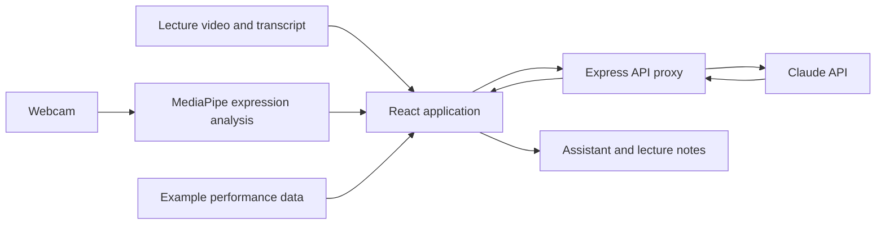

# Lectura

An AI-powered learning assistant that combines computer vision and generative AI to support students as they watch educational videos.

## Overview

Lectura is a collaborative educational technology prototype designed to help students review lecture material and get assistance without interrupting their learning experience.

## Features

- Embedded YouTube lecture playback and transcript-based topic extraction every two minutes.
- Webcam-based facial expression analysis using MediaPipe, with heuristic signals that trigger supportive check-ins.
- Context-aware AI assistant powered by Claude.
- Topic-level alerts based on example student performance records.
- End-of-session lecture summaries and downloadable notes.

## Tech stack

| Component | Technology |
| --- | --- |
| Frontend | React, JavaScript, Vite |
| Backend | Node.js, Express |
| Computer vision | MediaPipe Face Landmarker |
| Generative AI | Anthropic Claude API |
| Video | YouTube playback and transcript processing |

## Architecture



## Local setup

Use Node.js 22.12+ or a compatible newer release. Internet access, a webcam and an Anthropic API key are needed for the full experience.

```bash
npm ci
cp .env.example .env
```

Add your own `ANTHROPIC_API_KEY` to `.env`. Never commit this file. Then run:

```bash
npm start
```

Open http://localhost:5173 and allow camera access when starting a session. The local API proxy runs on port 3001.

## Limitations

- Facial expressions are heuristic cues, not reliable measurements of comprehension or emotional state.
- The prototype depends on external model assets, video services and the Claude API.
- The included performance records have no visible direct identifiers, but their provenance must be confirmed before public release.
- The API proxy is intended for local development; authentication, request validation and rate limits are needed before public deployment.

## Credits

Collaborative student project. Contributor names and individual responsibilities should be confirmed before public release.
